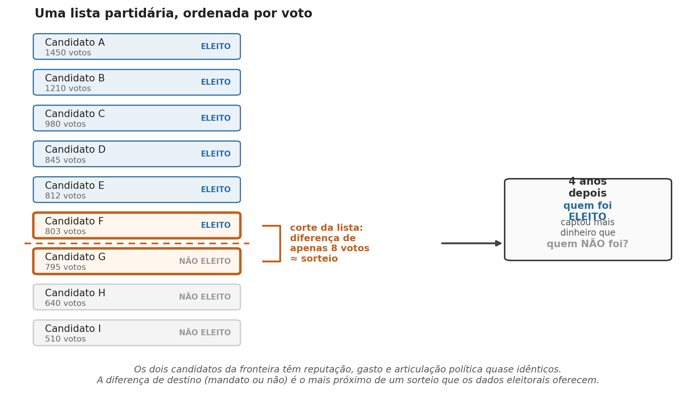

# Financiamento de campanha e retorno eleitoral

Estudo causal sobre dados públicos do TSE: **vencer uma eleição por
poucos votos aumenta a arrecadação de campanha na eleição seguinte?**

Recorte: vereador, Rio Grande do Sul, painel empilhado de duas transições
eleitorais (2016→2020 e 2020→2024). Desenho: regressão descontínua (RDD)
comparando o último candidato eleito de cada lista partidária com o
primeiro suplente — os dois candidatos mais próximos possíveis de terem
sido sorteados para o mandato.

**[→ Site do projeto, com o resultado explicado](https://pedroveit.github.io/financiamento-eleitoral-rs/painel.html)**

> ⚠️ **Resultado:** a regra de decisão pré-registrada (fixada em código
> antes de rodar qualquer análise) classificou o efeito como **não
> identificado com a robustez exigida** — há sinal positivo consistente,
> mas pequeno. Ver [`docs/resultados.md`](docs/resultados.md) para a
> leitura completa, incluindo por que isso não é o mesmo que "não achei
> nada".

---

## Por que este desenho

Candidatos com mais chance de vencer também atraem mais doação — então
correlacionar gasto com voto mistura causa e consequência. Este projeto
isola o efeito comparando pares de candidatos cuja diferença de destino
(eleito ou não) foi decidida por uma margem mínima de votos, dentro da
mesma lista partidária:



## Pipeline

```
CSVs do TSE ──▶ DuckDB (SQL) ──▶ variável de corte ──▶ RDD (Python) ──▶ figuras
```

- **SQL** (DuckDB) faz a ingestão e a construção da margem de votos via
  window functions — o núcleo está em
  [`sql/02_calculo_margem_disputa.sql`](sql/02_calculo_margem_disputa.sql).
- **Python** faz pareamento entre eleições, estimação causal (`rdrobust`
  + estimador próprio), bateria de robustez e regras de decisão
  pré-registradas que classificam automaticamente o resultado.
- **53 testes automatizados**, incluindo validação contra um efeito
  causal conhecido em dados sintéticos antes de qualquer execução real.

## Resultado principal

| | 1ª rodada (2020→2024) | 2ª rodada (2016→2020 + 2020→2024) |
|---|---|---|
| efeito estimado (τ) | +0,156 | **+0,085** |
| IC 95% | [−0,013, +0,363] | [−0,036, +0,230] |
| p-valor | 0,068 | 0,152 |
| n | 4.662 | 9.275 |

Dobrar a amostra reduziu o efeito estimado e o intervalo de confiança ao
mesmo tempo — sinal de que a primeira estimativa estava parcialmente
inflada por ruído. Relatório completo, bateria de robustez e a leitura
honesta do resultado em [`docs/resultados.md`](docs/resultados.md).

## Rodar localmente

```bash
pip install -r requirements.txt
make demo     # pipeline completo em dados sintéticos, ~1 min
make test     # 53 testes
```

Com dados reais do TSE, ver o passo a passo em
[`docs/plano_execucao.md`](docs/plano_execucao.md).

## O que este projeto não conclui

Não mede o efeito do dinheiro sobre votos (mede o inverso: o efeito de
vencer sobre o dinheiro captado depois). Não avalia partidos nem usa
cor por legenda em nenhum gráfico. Não generaliza além de vereador/RS.
Não trata "não identificado" como fracasso — é o resultado correto
quando a robustez pré-registrada não é atingida.

## Documentação

- [`docs/nota_metodologica_rdd.md`](docs/nota_metodologica_rdd.md) — por que este desenho identifica o que identifica, e o que não
- [`docs/resultados.md`](docs/resultados.md) — resultado completo e sua leitura
- [`docs/decisoes.md`](docs/decisoes.md) — decisões de projeto e bugs reais encontrados, com a razão de cada um
- [`docs/dicionario_dados.md`](docs/dicionario_dados.md) — tabelas, views e colunas
- [`docs/plano_execucao.md`](docs/plano_execucao.md) — como reproduzir com dados reais

---

Dados públicos do TSE (Creative Commons Atribuição) e IBGE/SIDRA.
Projeto pessoal, sem vínculo institucional.
**Autor:** Pedro ([@PedroVeit](https://github.com/PedroVeit)) · Licença MIT
